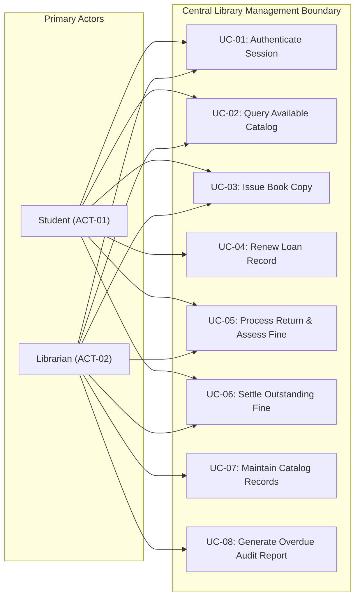
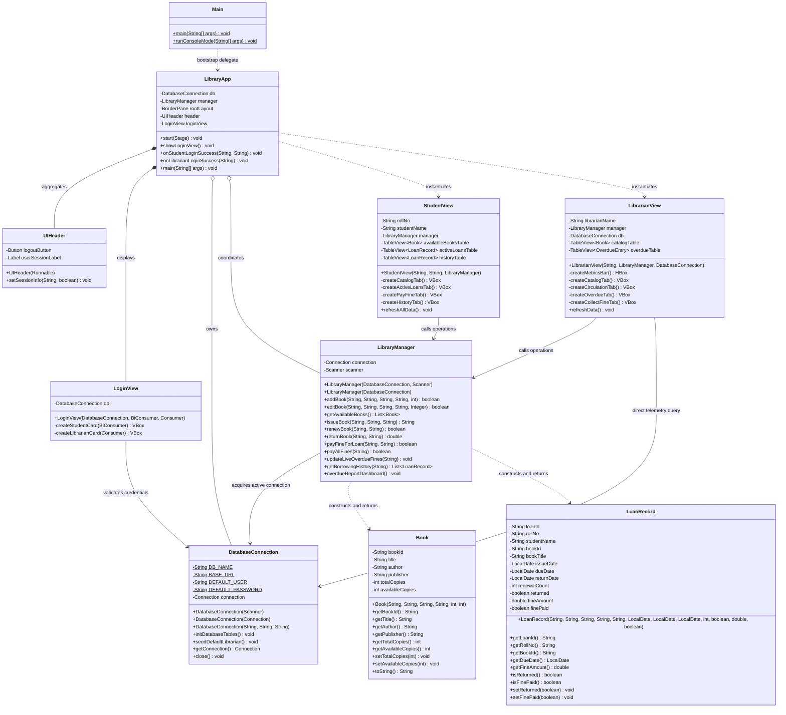
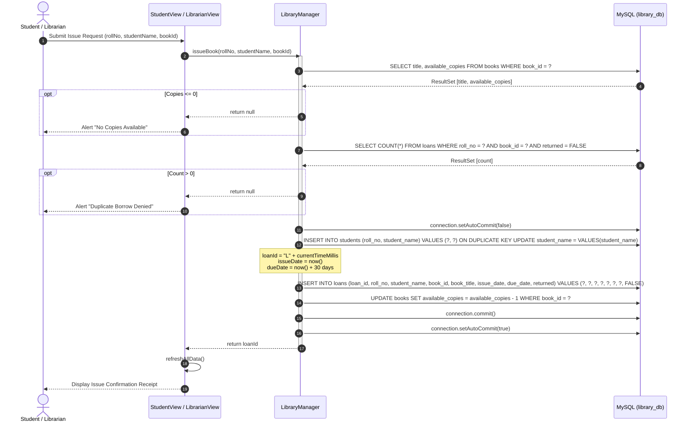
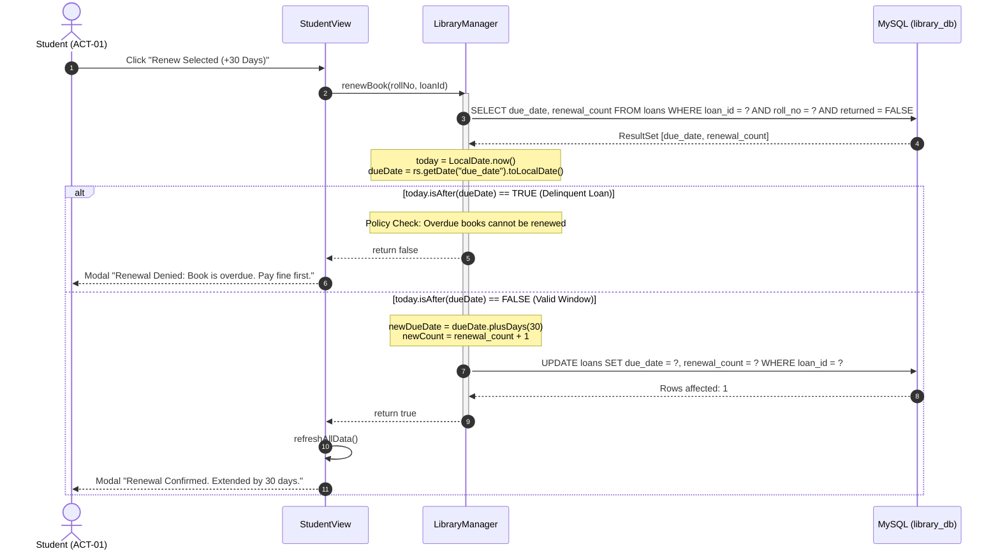
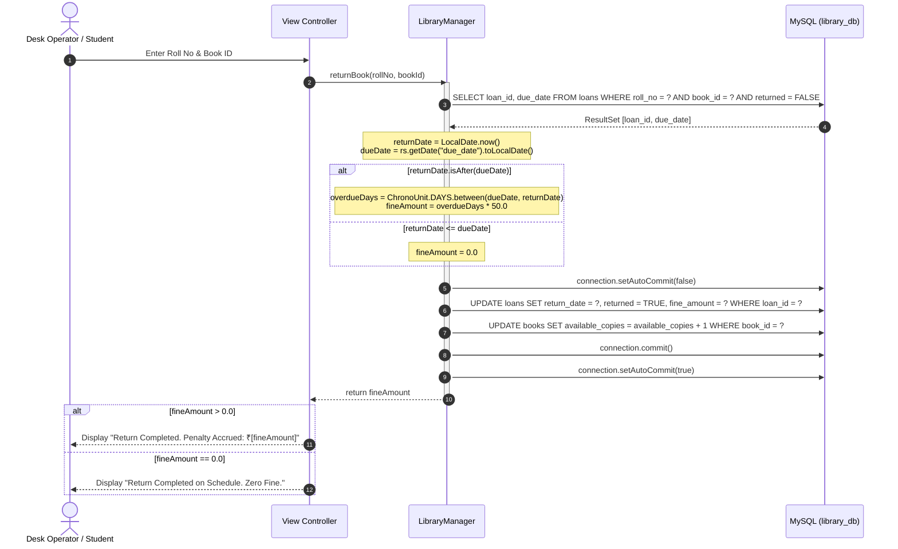
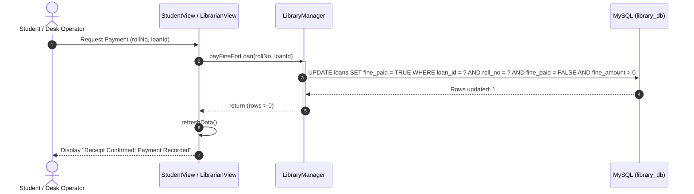

# System Design Specification (SDS)
## Gautam Buddha Central Library Management System
**Institution:** Babasaheb Bhimrao Ambedkar University, Lucknow  
**Document Ref:** BBAU-LMS-SDS-2026-V1  
**Target Environment:** OpenJDK 17+, OpenJFX 21, MySQL Server 8.0, Apache Maven  

---

## 1. Requirements & Use Case Analysis

### 1.1 Scope and System Boundary
The system automates circulation, inventory tracking, and fee reconciliation for the Gautam Buddha Central Library at BBAU Lucknow. The application boundary encompasses a desktop client layer built in JavaFX interacting with a relational persistence layer hosted on MySQL via direct JDBC transactions.

### 1.2 Actors
1. **Student (`ACT-01`):** An authenticated university member identified by roll number. Permitted to browse catalog data, request checkouts, initiate renewals within policy limits, and settle outstanding penalties.
2. **Librarian (`ACT-02`):** Administrative staff member operating circulation desks and managing inventory. Permitted to execute catalog modifications, process checkouts/returns on behalf of students, review delinquency dashboards, and record fine receipts.

---

### 1.3 Use Case Model



---

### 1.4 Detailed Use Case Specifications

#### Use Case: UC-03 — Issue Book Copy
| Attribute | Specification |
|:---|:---|
| **Identifier** | `UC-03` |
| **Primary Actor** | Student (`ACT-01`), Librarian (`ACT-02`) |
| **Description** | Deducts an available book copy and creates an active loan record with a fixed 30-day return deadline. |
| **Pre-conditions** | 1. Student record exists in `students` table.<br>2. Book record exists in `books` table with `available_copies >= 1`.<br>3. Student does not currently hold an unreturned copy of the requested `bookId`. |
| **Post-conditions** | 1. New row inserted into `loans` with `returned = FALSE`.<br>2. `books.available_copies` decremented by 1.<br>3. Transaction committed atomically. |

##### Main Execution Path
1. Actor submits `rollNo`, `studentName`, and `bookId`.
2. System queries `books` table to verify stock availability (`available_copies > 0`).
3. System verifies that no existing record matches `roll_no = ? AND book_id = ? AND returned = FALSE`.
4. System sets `issueDate = LocalDate.now()` and `dueDate = issueDate.plusDays(30)`.
5. System starts database transaction (`connection.setAutoCommit(false)`).
6. System executes `INSERT INTO loans` with auto-generated identifier `L<timestamp>`.
7. System executes `UPDATE books SET available_copies = available_copies - 1 WHERE book_id = ?`.
8. System executes `connection.commit()`.
9. System displays transaction confirmation with calculated due date.

##### Alternate & Error Paths
* **2a. Stock Exhausted:** If `available_copies == 0`, system aborts transaction and returns error message: *"No copies available for checkout"*.
* **3a. Concurrent Active Loan:** If active loan exists for the same roll number and book ID, system rejects the operation with: *"Active unreturned loan already exists for this student"*.
* **6a. SQL Error Encountered:** System executes `connection.rollback()`, restores `autoCommit = true`, and presents database error code.

---

#### Use Case: UC-04 — Renew Loan Record
| Attribute | Specification |
|:---|:---|
| **Identifier** | `UC-04` |
| **Primary Actor** | Student (`ACT-01`) |
| **Description** | Extends the loan duration by an additional 30 calendar days, provided the renewal occurs on or prior to the current due date. |
| **Pre-conditions** | Active loan row exists with `returned = FALSE` for the calling student. |
| **Post-conditions** | `loans.due_date` updated to `due_date + 30 days`, `loans.renewal_count` incremented by 1. |

##### Main Execution Path
1. Student selects a loan entry by `loanId`.
2. System fetches `due_date` from `loans` where `loan_id = ? AND roll_no = ? AND returned = FALSE`.
3. System checks boundary condition: `LocalDate.now().isAfter(dueDate)`.
4. If `false` (on or before due date), system calculates `newDueDate = dueDate.plusDays(30)`.
5. System executes SQL update: `UPDATE loans SET due_date = ?, renewal_count = renewal_count + 1 WHERE loan_id = ?`.
6. System displays renewed deadline to user.

##### Alternate & Error Paths
* **3a. Overdue Condition:** If `LocalDate.now().isAfter(dueDate)` is `true`, system blocks renewal. Operation terminates with message: *"Renewal prohibited: Item is overdue. Return book and clear penalties."*

---

#### Use Case: UC-05 — Process Return & Assess Fine
| Attribute | Specification |
|:---|:---|
| **Identifier** | `UC-05` |
| **Primary Actor** | Student (`ACT-01`), Librarian (`ACT-02`) |
| **Description** | Closes an active loan, assesses delinquent duration, applies fine rules at ₹50.00/day, and restores book inventory. |
| **Pre-conditions** | Loan record exists with matching `rollNo` and `bookId` where `returned = FALSE`. |
| **Post-conditions** | `loans.returned` set to `TRUE`, `loans.return_date` recorded, `loans.fine_amount` saved, and `books.available_copies` incremented by 1. |

##### Main Execution Path
1. User provides `rollNo` and `bookId`.
2. System retrieves `dueDate` and `loanId` from `loans`.
3. System compares `returnDate = LocalDate.now()` with `dueDate`:
   - If `returnDate.isAfter(dueDate)`: `overdueDays = ChronoUnit.DAYS.between(dueDate, returnDate)`, `fine = overdueDays * 50.0`.
   - Else: `fine = 0.0`.
4. System sets `connection.setAutoCommit(false)`.
5. System updates `loans`: `return_date = ?, returned = TRUE, fine_amount = ?`.
6. System updates `books`: `available_copies = available_copies + 1`.
7. System commits transaction.
8. System outputs return receipt with fine summary.

---

## 2. Structural Architecture (Class Diagram)

The codebase follows a decoupled architecture separating UI layout controllers, a business transaction manager, database connectivity management, and domain data models.



### 2.1 Component Dictionary
* **`Book` / `LoanRecord`:** Immutable domain entities carrying state retrieved from SQL records.
* **`DatabaseConnection`:** Singleton-style database abstraction ensuring idempotent DDL table creation (`CREATE TABLE IF NOT EXISTS`) and default credential seeding (`lib123`).
* **`LibraryManager`:** Transaction manager providing boundary enforcement (check-before-act), fine math, and JDBC resource isolation (`try-with-resources`).
* **`LibraryApp` / `StudentView` / `LibrarianView`:** JavaFX presentation containers rendering reactive `TableView` controls, search filtration predicates, and dialog confirmations.

---

## 3. Dynamic Behavioral Specifications (Sequence Diagrams)

### 3.1 Book Checkout Workflow (`issueBook`)
Illustrates transactional boundary execution, copy deduction, and duplicate prevention.



---

### 3.2 30-Day Renewal Policy Verification (`renewBook`)
Illustrates date comparison logic protecting against renewal of overdue loans.



---

### 3.3 Return Transaction with Fine Assessment (`returnBook`)
Details fine computation using temporal delta arithmetic and stock inventory restoration.



---

### 3.4 Fine Collection Reconciliation (`payFineForLoan`)
Illustrates fine settlement clearing outstanding dues on loans.



---

## 4. Database Schema Mapping & Constraints

```
+-------------------------------------------------------------------------------------------------+
|                                     RELATIONAL SCHEMA BINDINGS                                   |
+-------------------+-----------------------------+-----------------------------------------------+
| Table             | Primary Key                 | Foreign Key Constraints                       |
+-------------------+-----------------------------+-----------------------------------------------+
| librarians        | librarian_id (VARCHAR 50)   | None                                          |
| students          | roll_no (VARCHAR 50)        | None                                          |
| books             | book_id (VARCHAR 50)        | None                                          |
| loans             | loan_id (VARCHAR 50)        | fk_loan_student -> students(roll_no)          |
|                   |                             | fk_loan_book    -> books(book_id)             |
+-------------------+-----------------------------+-----------------------------------------------+
```

### Business Validation Invariants Enforced by Architecture
1. **Stock Non-Negativity:** `available_copies` cannot drop below `0`. Checked programmatically prior to SQL issuance and guaranteed by transactional isolation.
2. **Deterministic Fine Rate:** Fine calculation is strictly defined as `MAX(0, ChronoUnit.DAYS.between(dueDate, returnDate)) * 50.0`.
3. **Renewal Monotonicity:** Renewals are strictly prohibited once `LocalDate.now().isAfter(dueDate) == true`.
